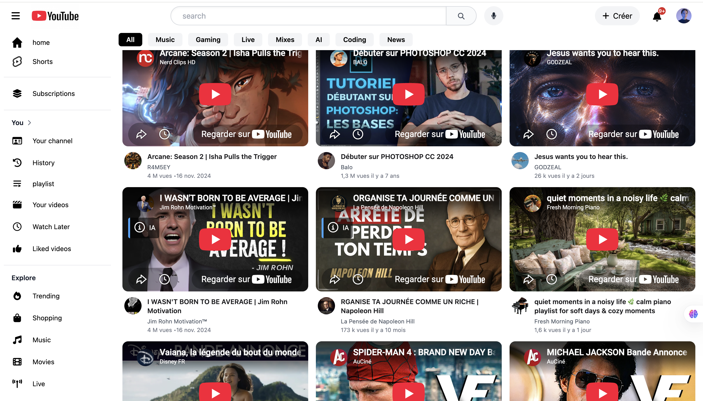

# YouTube Clone (UI)

Clone de l'interface de YouTube réalisé en pur **HTML** et **Tailwind CSS**, dans le but de m'entraîner sur la mise en page, le responsive design et la reproduction fidèle d'une interface complexe.


## 🖼️ Aperçu

> Ajoute ici une capture d'écran ou un GIF du rendu (place le fichier dans `images/preview.png` puis remplace le lien ci-dessous).

```

```

## ✨ Fonctionnalités

- Barre de navigation fixe (logo, recherche, icônes d'action, avatar)
- Menu latéral (sidebar) avec sections *Accueil*, *Abonnements*, *Bibliothèque*, *Explorer*, *Paramètres*
- Bandeau de catégories horizontal scrollable
- Grille de vidéos responsive (1 à 3 colonnes selon la taille d'écran)
- Lecteurs vidéo intégrés via iframe YouTube
- Design responsive (mobile / tablette / desktop)

## 🛠️ Stack technique

- **HTML5** — structure de la page
- **Tailwind CSS** (via CDN) — mise en forme utilitaire
- **Font Awesome** — icônes

## 📁 Structure du projet

```
youtube-clone/
├── index.html        # Page principale
├── images/            # Miniatures, avatars, icônes locales
├── LICENSE
└── README.md
```

## 🚀 Lancer le projet en local

Aucune installation ni dépendance requise : le projet est une page statique.

1. Clone le dépôt
   ```bash
   git clone https://github.com/<ton-user>/youtube-clone.git
   cd youtube-clone
   ```
2. Ouvre `index.html` dans ton navigateur, ou utilise une extension type *Live Server* (VS Code) pour le rechargement automatique.

## 🌱 Workflow Git (Gitflow)

Ce dépôt suit une organisation **Gitflow** simplifiée :

| Branche | Rôle |
|---|---|
| `main` | Code stable, prêt à être déployé/présenté |
| `develop` | Branche d'intégration des nouvelles fonctionnalités |
| `feature/*` | Une branche par fonctionnalité (ex: `feature/dark-mode`) |
| `fix/*` | Correction de bug isolée |

Workflow type pour une nouvelle fonctionnalité :

```bash
git checkout develop
git pull
git checkout -b feature/nom-de-la-feature

# ... travail + commits ...

git push -u origin feature/nom-de-la-feature
# Ouvrir une Pull Request vers develop
```

Une fois `develop` stable, une Pull Request est ouverte vers `main` pour publier une nouvelle version.

Convention de commit utilisée : [Conventional Commits](https://www.conventionalcommits.org/) (`feat:`, `fix:`, `style:`, `docs:`, `refactor:`...).

## 🗺️ Pistes d'amélioration

- [ ] Mode sombre
- [ ] Recherche fonctionnelle (filtrage des cartes)
- [ ] Page de lecture vidéo dédiée
- [ ] Menu latéral repliable
- [ ] Passage en composants (React/Vue) pour une V2

## ⚠️ Avertissement

Projet réalisé à des fins d'apprentissage et de démonstration (portfolio). Il n'est affilié à YouTube/Google d'aucune manière ; les logos et contenus vidéo appartiennent à leurs propriétaires respectifs.

## 👤 Auteur

**[Ton Nom]**
- Portfolio : [lien]
- LinkedIn : [lien]
- GitHub : [@ton-user](https://github.com/ton-user)

## 📄 Licence

Ce projet est sous licence MIT — voir le fichier [LICENSE](LICENSE) pour plus de détails.
